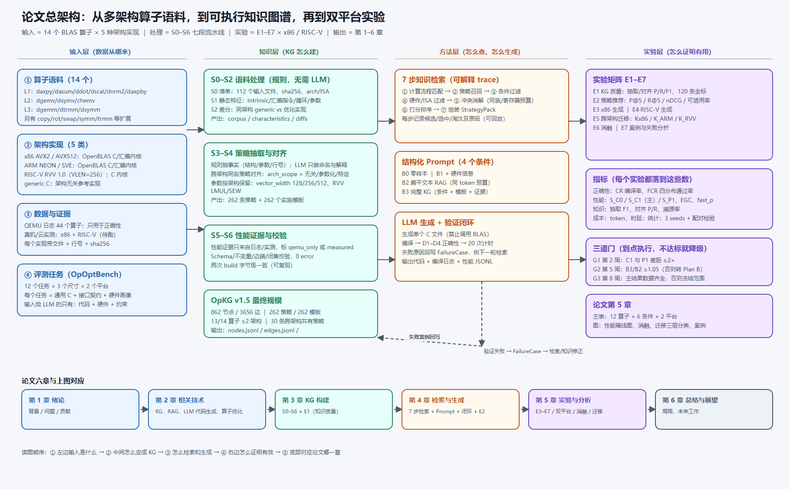
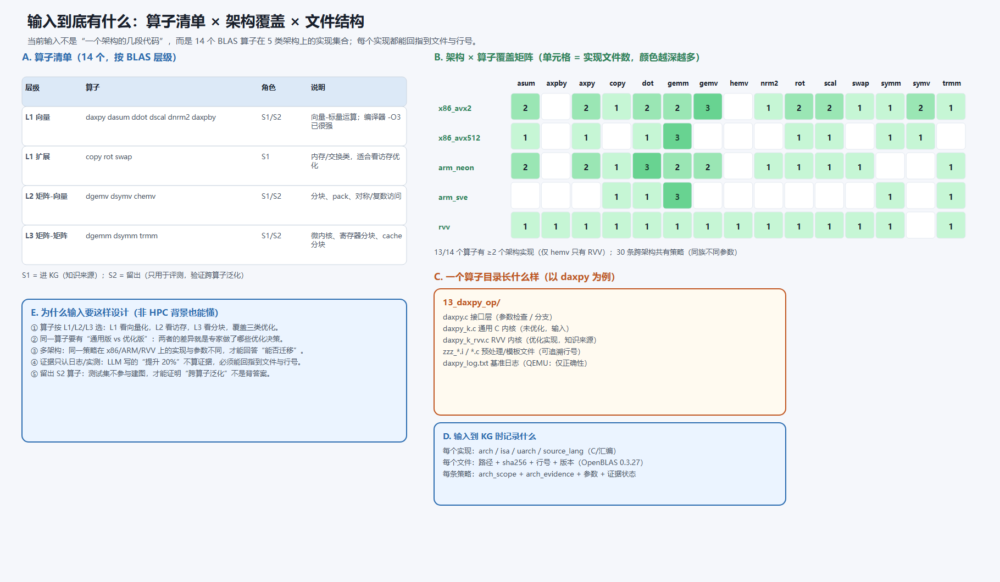
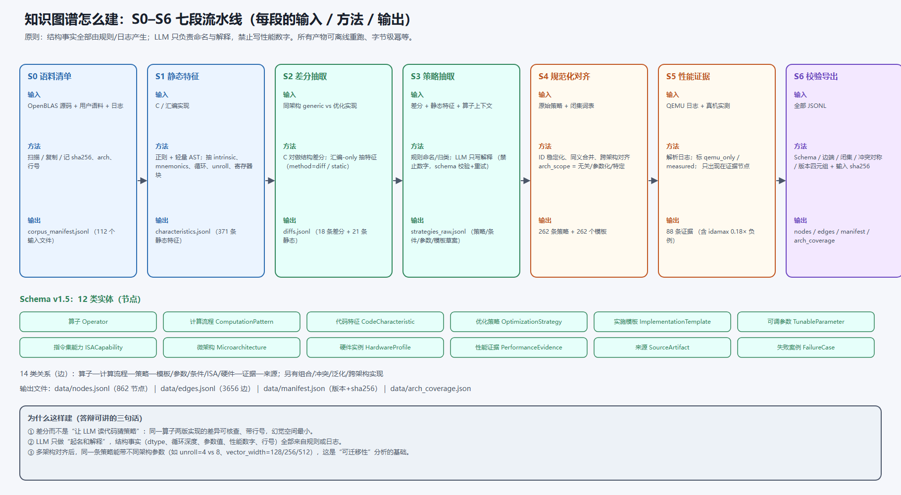
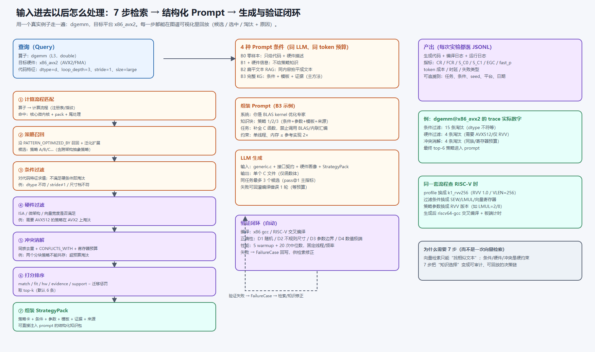
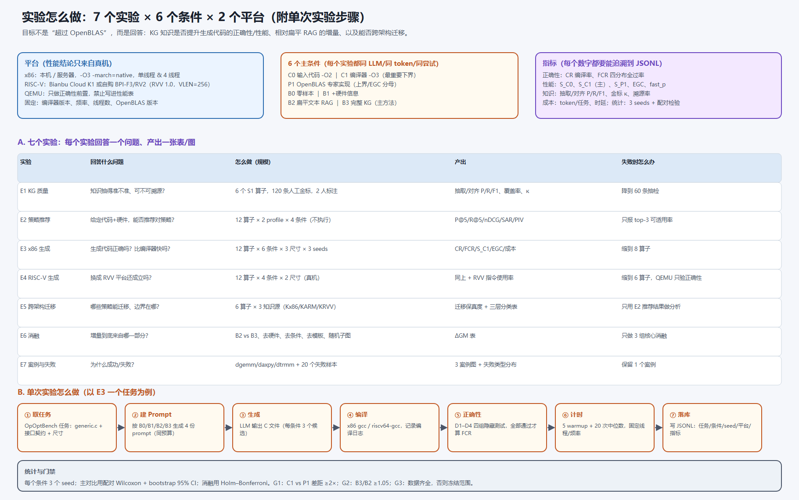
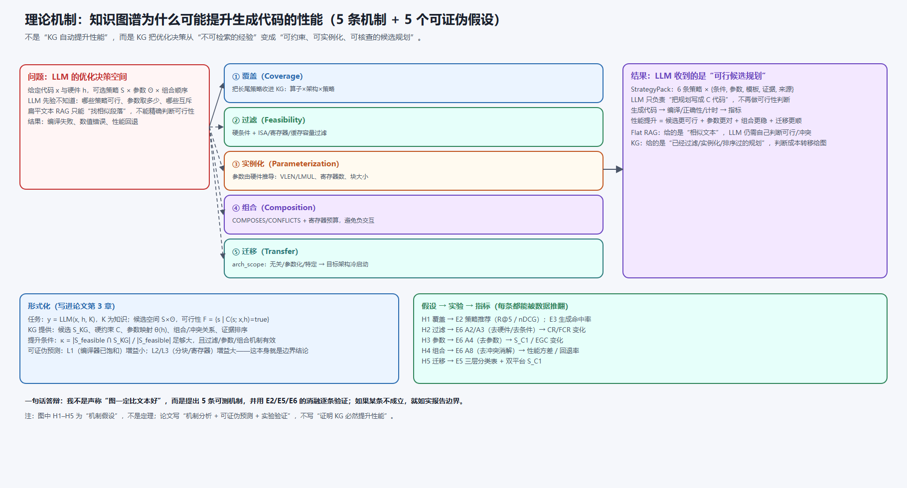

# 14 论文架构与流程说明（给非 HPC 背景的完整版）

> 2026-11-12｜Lead｜配套图：`fig1`–`fig6`（SVG 可编辑，PNG 可直接插论文/PPT）
> 打开 `index.html` 可一页看全六张图；本文件用大白话解释"输入是什么、怎么处理、怎么实验、为什么能提升"。
> 理论机制、创新点、工作量与答辩话术另见 [`../15_理论论证与工作量说明.md`](../15_理论论证与工作量说明.md)。

---

## 0. 先记住三句话

1. **输入**：14 个 BLAS 算子 × 5 类架构实现（x86 AVX2/AVX512、ARM NEON/SVE、RISC-V RVV）+ 通用 C 参考实现 + 基准日志。
2. **处理**：S0–S6 七段流水线，把"同一算子两版代码的差异"变成"带适用条件、参数、实施模板、性能证据、来源行号"的策略知识图谱（862 节点 / 3656 边）。
3. **实验**：12 个算子 × 6 个条件 × 2 个平台（x86 + RISC-V 真机），回答四件事：生成对不对、快不快、比扁平文本 RAG 强多少、能不能跨架构迁移。

---

## 1. 图 1：论文总架构（一页看懂）



四层从左到右：

| 层 | 回答什么问题 | 里面有什么 |
|---|---|---|
| **输入层** | 数据从哪来？ | ① 14 个算子语料；② 5 类架构实现；③ 日志/实测证据；④ 12 个评测任务 |
| **知识层** | KG 怎么建？ | S0–S2 语料处理 → S3–S4 策略抽取/对齐 → S5–S6 证据/校验 → OpKG v1.5 |
| **方法层** | 怎么查、怎么生成？ | 7 步检索 → 结构化 Prompt（B0–B3）→ LLM 生成 → 验证闭环 |
| **实验层** | 怎么证明有用？ | E1–E7 实验 + 指标 + 三道门 + 论文第 5 章 |

底部一行是**论文六章**与上面四层的对应关系（第 3 章=知识层，第 4 章=方法层，第 5 章=实验层）。

> 读图顺序：**左边输入 → 中间建图 → 中右检索生成 → 右边实验 → 底部论文**。

---

## 2. 图 2：输入到底是什么（哪些算子、哪些架构、什么文件）



### 2.1 算子：14 个，按 BLAS 层级选

| 层级 | 算子 | 为什么选它 |
|---|---|---|
| **L1 向量** | daxpy、dasum、ddot、dscal、dnrm2、daxpby | 一次只算向量元素；主要看 SIMD 向量化、多累加器、尾处理。编译器 `-O3` 已经很强，用来检验"提升是不是只是开了 O3" |
| **L1 扩展** | copy、rot、swap | 内存/交换类；主要看访存、对齐、数据重排 |
| **L2 矩阵-向量** | dgemv、dsymv、chemv | 矩阵乘向量；主要看分块、pack、对称/复数访问 |
| **L3 矩阵-矩阵** | dgemm、dsymm、trmm | 矩阵乘矩阵；主要看微内核、寄存器分块、cache 分块（最体现"专家知识"） |

> 其中 **S1 = 进 KG**（daxpy、dasum、ddot、dgemv、dgemm、dtrmm 等），**S2 = 留出**（dscal、dnrm2、daxpby、dsymv、chemv、dsymm），S2 不参与建图，只用于测试"跨算子泛化"。

### 2.2 架构：5 类，来自 OpenBLAS v0.3.27

| 架构 | 典型实现形式 | 说明 |
|---|---|---|
| x86 AVX2 | C 微内核 + 汇编 | 256 位向量、16 个向量寄存器 |
| x86 AVX512 | C 微内核 + 汇编 | 512 位向量、32 个向量寄存器 |
| ARM NEON | C + 汇编 | 128 位向量 |
| ARM SVE | C/汇编 | 可变长向量（这里按 256 位记录） |
| RISC-V RVV | C（RVV intrinsic） | RVV 1.0，VLEN=256，LMUL/SEW 可调 |
| generic | 纯 C | 架构无关参考实现（差分里的"旧版"） |

**覆盖结果**：13/14 个算子有 ≥2 个架构实现；共 70 个实现文件；**30 条跨架构共有策略**（同一条策略在不同架构上参数不同）。

### 2.3 一个算子目录长什么样（以 daxpy 为例）

```text
13_daxpy_op/
  daxpy.c          接口层（参数检查、分支）
  daxpy_k.c        通用 C 内核（未优化 → 作为 LLM 的输入）
  daxpy_k_rvv.c    RVV 内核（优化实现 → 知识来源）
  zzz_*.i / *.c    预处理/模板文件（可追溯行号）
  daxpy_log.txt    基准日志（QEMU：只用于正确性）
```

### 2.4 输入给 LLM 的到底是什么？

不是把整个知识图谱塞进去，而是：

```text
任务：补全 C 函数 daxpy_k（只写函数体）
输入代码：generic.c（通用 C 实现）
接口契约：函数签名、参数语义、不变量
硬件画像：x86_avx2 / AVX2、256 位、16 个向量寄存器、L1/L2 大小…
约束：禁止调用 BLAS、单线程、内存 ≤ 参考实现 2 倍
知识（只有 B3 条件才有）：检索到的 6 条策略卡（条件 + 参数 + 模板 + 证据 + 来源）
```

B0 只给前三行；B1 加硬件画像；B2 把策略卡拍平成文本；B3 给结构化策略卡。

---

## 3. 图 3：知识图谱怎么建（S0–S6 详细流程）



### S0 语料清单（不联网、可复现）

- **做什么**：扫描 OpenBLAS 源码和你的语料，把每个实现文件复制到 `data/corpus_multiarch/<arch>/<op>/`，记录路径、sha256、架构、ISA、行号。
- **为什么**：论文里每个数字都要能追溯到具体文件；换机器也能重建。
- **产出**：`corpus_manifest.jsonl`（112 个输入文件）。

### S1 静态特征（能算的绝不让 LLM 猜）

- **C 内核**：抽 intrinsic（`_mm256_*`、`vfmacc`、`svfloat64`）、循环层数、展开因子、pack/copy、prefetch、对齐假设。
- **汇编内核**：抽指令 mnemonics 计数（`vfmadd`、`vmla`、`fmla`、`prefetcht0`、`prfm`）、向量宽度、FMA、寄存器分块线索。
- **为什么**：这些是"事实"，LLM 容易编；规则抽出来可核查。
- **产出**：`characteristics.jsonl`（371 条静态特征）。

### S2 差分抽取（本方法的核心）

- **做什么**：同一算子的"通用 C 版"和"优化版"逐段对比，记录差异：多了哪些 intrinsic、循环展开从 4 变 8、累加器从 4 个标量变 8 个向量、是否加尾处理等。
- **输出**：一条"变换实例"，带 before/after 行号，例如：

```json
{"op":"gemm","actions":["vectorize","blocking","unroll","tail_mask"],
 "params":{"reg_block_n":8,"k_unroll":8,"lmul":2,"sew":64},
 "anchors":{"before":"dgemm_k.c:19-120","after":"dgemm_k_rvv.c:46-213"}}
```

- **为什么**：差异是"专家已经做过的优化决策"，比让 LLM 看单版代码猜策略可靠得多。
- **产出**：`diffs.jsonl`（C 差分 18 条 + 汇编静态特征 21 条）。

### S3 策略抽取（LLM 只做命名和解释）

- 规则先给每条差分起"动作名"（vectorize/tile/unroll/prefetch/tail_handle…），LLM 只写"为什么这样改能提速"和"适用条件"。
- **硬约束**：LLM 不许写任何性能数字、硬件数值、文件名；JSON schema 校验失败就重试。
- **产出**：262 条策略（原始）。

### S4 规范化与对齐

- 统一 ID 和名称（同一策略不同叫法合并）；
- **跨架构对齐**：同一条策略在 x86/ARM/RVV 上合并，但保留各架构参数，并标 `arch_scope`：
  - `arch_agnostic`（架构无关，如"减少访存"）
  - `parameterized`（同族但参数不同，如 vector_width=128/256/512、unroll=4/8）
  - `arch_specific`（架构特定，如 `vfmacc`、`prefetcht0`、mask 尾处理）
- **产出**：262 条策略 + 262 个实施模板。

### S5 性能证据（只认日志/实测）

- 解析 QEMU/真机日志，生成 `PerformanceEvidence` 节点；
- QEMU 的证据标 `qemu_only`、`confidence=0.35`、`rerun_needed=true`，**不参与性能排序**；
- 保留负例（如 idamax 0.18×），证明"专家实现不一定更快"。
- **产出**：88 条证据。

### S6 校验与导出

- 校验：ID 唯一、边两端存在、类型在闭集、条件谓词合法、冲突边对称、模板槽位完整、版本四元组 + 输入 sha256。
- **产出**：`nodes.jsonl`（862 节点）、`edges.jsonl`（3656 边）、`manifest.json`、`arch_coverage.json`。

### 最终"一条策略"长什么样

```json
{
  "id": "stg:gemm:tile_x",
  "type": "OptimizationStrategy",
  "name": "寄存器分块 + cache 分块",
  "properties": {
    "family": "分块",
    "arch_scope": "parameterized",
    "conditions": [{"pred":"dtype","op":"in","value":["d","s"],"hard":true},
                   {"pred":"loop_depth","op":"ge","value":2,"hard":true}],
    "arch_parameters": {"x86_avx2":{"reg_block_n":4}, "rvv":{"reg_block_n":8,"lmul":2}},
    "template_id": "tpl:gemm:tile_x",
    "evidence_status": "source_only"
  },
  "provenance": {"source_file":".../dgemm_k.c","line_start":19,"line_end":120}
}
```

---

## 4. 图 4：输入进去以后怎么处理（7 步检索 + 生成闭环）



### 4.1 查询长什么样

```text
算子：dgemm（L3，double）
目标硬件：x86_avx2（AVX2/FMA，256 位）
代码特征：dtype=d、loop_depth=3、stride_x=1、size_regime=large
```

### 4.2 七步检索（每一步都可回放）

| 步 | 做什么 | 真实例子（dgemm @ x86_avx2） |
|---|---|---|
| ① 计算流程匹配 | 算子 → 计算流程（注册表/指纹） | 命中"核心微内核 + pack + 尾处理" |
| ② 策略召回 | 沿图谱边召回 + 跨架构抽象扩展 | 候选几十条策略 |
| ③ 条件过滤 | 对代码特征求值，硬条件不满足即淘汰 | 淘汰 **15 条**（dtype 不符等） |
| ④ 硬件过滤 | ISA/微架构/向量宽度是否满足 | 淘汰 **4 条**（需要 AVX512 或只有 RVV） |
| ⑤ 冲突消解 | 同族去重 + 冲突边 + 寄存器预算 | 淘汰 **4 条**（同族/超预算） |
| ⑥ 打分排序 | match/fit/hw/evidence/support − 迁移惩罚 | 取 top-6 |
| ⑦ 组装 StrategyPack | 策略 + 条件 + 参数 + 模板 + 证据 + 来源 | 注入 prompt |

> 在可视化里点「检索回放」可以逐步看：橙色=候选、绿色=选中、红色=淘汰，右侧有每步原因。

### 4.3 四种 Prompt 条件（为什么必须有 B2）

| 条件 | 给 LLM 什么 | 作用 |
|---|---|---|
| B0 零样本 | 代码 + 任务 | 下界 |
| B1 + 硬件信息 | 代码 + 硬件描述 | 分离"知道硬件"与"有策略知识" |
| **B2 扁平文本 RAG** | 把 B3 的策略卡**拍平成文本**，同 token 预算 | **最关键对照**：证明增量来自"图结构"而不是"多给了文字" |
| B3 完整 KG | 结构化策略卡（条件/参数/模板/证据） | 主方法 |

### 4.4 生成与验证闭环

1. LLM 输出**单个 C 文件**（禁止调用 BLAS）；
2. 编译（x86 gcc / RISC-V 交叉编译）；
3. 正确性：D1 随机、D2 不规则尺寸、D3 参数边界、D4 数值极端，四组全过才算 FCR；
4. 性能：5 次 warmup + 20 次计时取中位数，固定线程/频率；
5. 失败原因写 `FailureCase`，下一轮检索可用；
6. 每次实验落 JSONL（任务/条件/seed/平台/指标），可一键复算。

---

## 5. 图 5：实验怎么做（做哪些、怎么实施、数字怎么读）



### 5.1 三条轴

- **条件轴**：C0（输入 -O2）、C1（编译器 -O3，**最重要下界**）、P1（OpenBLAS 专家实现，上界/EGC 分母）、B0/B1/B2/B3（方法对比）；
- **任务轴**：12 个算子 × 3 个尺寸；
- **平台轴**：x86 真机 + RISC-V 真机（Bianbu Cloud / BPI-F3 / RV2）；QEMU 只验正确性。

### 5.2 七个实验（每个回答一个问题）

| 实验 | 回答什么 | 怎么做 | 产出 |
|---|---|---|---|
| **E1 KG 质量** | 知识抽得准不准、可不可溯源？ | 6 个 S1 算子、120 条人工金标、2 人标注 | 抽取/对齐 P/R/F1、覆盖率、κ |
| **E2 策略推荐** | 给定代码+硬件，能否推荐对策略？ | 12 算子 × 2 profile × 4 条件（不执行代码） | P@5、R@5、nDCG、可适用率 SAR |
| **E3 x86 生成** | 生成代码正确吗？比编译器快吗？ | 12 算子 × 6 条件 × 3 尺寸 × 3 seeds | CR、FCR、S_C1、EGC、成本 |
| **E4 RISC-V 生成** | 换 RVV 平台还成立吗？ | 12 算子 × 4 条件 × 2 尺寸（真机） | 同上 + RVV 指令使用率 |
| **E5 跨架构迁移** | 哪些策略能迁移、边界在哪？ | 6 算子 × 3 知识源（Kx86/KARM/KRVV） | 迁移保真度 + 三层分类表 |
| **E6 消融** | 增量到底来自哪一部分？ | B2 vs B3、去硬件、去条件、去模板、随机子图 | ΔGM 表 |
| **E7 案例与失败** | 为什么成功/失败？ | dgemm/daxpy/dtrmm + 20 个失败样本 | 3 个案例图 + 失败类型分布 |

### 5.3 指标（不懂 HPC 也能读）

| 指标 | 含义 | 怎么算 |
|---|---|---|
| **CR** | 编译通过率 | 编译成功数 / 总数 |
| **FCR** | 功能正确率 | 四组隐藏测试全过的任务比例 |
| **S_C0** | 相对输入代码的加速比 | T_C0 / T |
| **S_C1** | 相对编译器 `-O3` 的加速比 | T_C1 / T（**主指标**，证明不是只赢在 O3） |
| **S_P1** | 达到 OpenBLAS 的百分比 | T_P1 / T |
| **EGC** | 差距闭合度：把"输入代码"到"OpenBLAS"的差距补上了多少 | (T_C0 − T) / (T_C0 − T_P1) |
| **fast_p** | 达到 p 倍加速的任务比例 | 用于看"多少任务真的变快" |
| **token/任务** | 成本 | 每次实验的 prompt + 输出 token |

> 如果只记三个数：**FCR（对不对）、S_C1（比编译器快多少）、B3/B2（比扁平 RAG 强多少）**。

### 5.4 单次实验的七个步骤（E3 一个任务为例）

1. 取任务：`OpOptBench` 的 `generic.c` + 接口契约 + 尺寸；
2. 建 Prompt：按 B0/B1/B2/B3 生成 4 份（同 token 预算）；
3. 生成：LLM 输出 C 文件（每条件 3 个候选）；
4. 编译：x86 gcc / riscv64-gcc，记录日志；
5. 正确性：D1–D4 四组隐藏测试；
6. 计时：5 warmup + 20 次中位数，固定线程/频率；
7. 落库：JSONL（任务/条件/seed/平台/指标）。

### 5.5 三道门与 Plan B

- **G1（第 2 周末）**：C1 相对 C0、P1 相对 C1 的差距在 ≥6 个算子上 ≥2×；不满足就换算子。
- **G2（第 5 周末）**：B3 相对 B2 的几何平均 ≥1.05；不满足就转 Plan B（KG 构建 + 策略推荐 + 跨架构分析为主，生成降为案例）。
- **G3（第 8 周末）**：主结果数据齐全；不齐就冻结范围，把时间投入写作。
- **Plan B 不是失败**：论文主线改成"结构化知识在什么条件下有用"的实证研究，E1/E2/E5 仍然支撑一篇完整硕士论文。

---

## 6. 图 6：理论机制（为什么 KG 可能提升性能）



- **五条机制**：M1 覆盖（长尾策略入库）→ M2 过滤（硬条件/ISA/寄存器）→ M3 参数实例化（由硬件推导）→ M4 组合冲突（COMPOSES/CONFLICTS + 预算）→ M5 跨架构迁移（arch_scope）。
- **五条可证伪假设**：H1–H5，分别由 E2、E6 A2/A3、E6 A4、E6 A8、E5 验证；不成立就写边界。
- **答辩口径**：不写"证明 KG 提升性能"，写"机制假设 + 充分条件（可行比例/参数正确率/无冲突比例/覆盖率单调）+ 实验验证"。
- 形式化细节、创新点、工作量清单见 [`../15_理论论证与工作量说明.md`](../15_理论论证与工作量说明.md)。

## 7. 论文六章怎么对应

| 章 | 内容 | 对应图/实验 |
|---|---|---|
| 第 1 章 绪论 | 背景、问题、贡献、组织结构 | 图 1 |
| 第 2 章 相关技术 | KG/RAG、LLM 代码生成、算子优化、评测基准 | — |
| 第 3 章 KG 构建 | 语料、Schema、S0–S6、质量评估 | 图 2 + 图 3 + E1 |
| 第 4 章 检索与生成 | 7 步检索、Prompt、生成闭环 | 图 4 + E2 |
| 第 5 章 实验与分析 | E3–E7、双平台、消融、迁移、案例 | 图 5 + E3–E7 |
| 第 6 章 总结与展望 | 结论、局限、未来工作 | — |

---

## 8. 术语表（给非 HPC 背景）

| 术语 | 一句话解释 |
|---|---|
| **BLAS** | 基础线性代数子程序库；daxpy、dgemm 等都是它的函数名（d=double 双精度） |
| **GEMM** | 矩阵乘矩阵（C = αAB + βC）；高性能计算最核心的算子 |
| **AVX2 / AVX512** | Intel x86 的 SIMD 指令集，一次能算 256/512 位数据（如 4/8 个 double） |
| **NEON / SVE** | ARM 的 SIMD 指令集；SVE 是可变长向量 |
| **RVV** | RISC-V 的向量扩展；VLEN 是向量寄存器位宽，LMUL 是寄存器分组倍数 |
| **微内核（microkernel）** | 手写的高度优化小循环，GEMM 性能的核心 |
| **分块（blocking/tiling）** | 把大矩阵切成能放进缓存的小块，减少访存 |
| **循环展开（unroll）** | 一次循环处理多个元素，减少循环开销、提高指令级并行 |
| **pack / 数据打包** | 把矩阵按内核需要的顺序重排到连续内存 |
| **prefetch** | 提前把数据取到缓存，掩盖内存延迟 |
| **roofline** | 性能上界模型：受算力或带宽限制，用来判断还有多少优化空间 |
| **QEMU** | 模拟器；可以跑 RISC-V 程序，但时间没有意义（只能验正确性） |
| **EGC** | 差距闭合度：把"输入代码"到"专家实现"的差距补上了多少（0~1） |
| **fast_p** | 达到 p 倍加速的任务比例 |
| **S1 / S2** | S1=进知识图谱的算子；S2=留出、只用于测试跨算子泛化的算子 |

---

## 9. 现在到哪一步了、明天做什么

**已完成**：
- 输入：14 算子 × 5 架构的多架构语料入库（70 个实现文件、112 个输入 sha256）；
- KG：862 节点 / 3656 边、262 策略 / 262 模板、30 条跨架构共有策略；
- 方法：7 步检索 + StrategyPack + 4 条件 Prompt 生成框架；
- 可视化：`graph.html`（性能模式）+ `graph_fast.html`（WebGL）；
- 实验：OpOptBench-12 任务清单、C0/C1/P1 基线脚本、daxpy 冒烟（C0→C1 2.4×）。

**还没做**：
- 板子/云实例（Bianbu Cloud 新入口 `cloud.spacemit.com`；Cloud-V 或买板兜底）；
- Morph 接入 StrategyPack；
- E1–E7 正式实验；
- 大论文正文（按 `09` 的 W1 开始写第 1 章）。

**明天三件事**：
1. 试 `https://cloud.spacemit.com/` 注册；不行就填 Cloud-V 或买 Orange Pi RV2；
2. 跑 `python 科研产出\kg_agent\run_demo.py`，打开 `graph_fast.html` 确认流畅；
3. 把 `StrategyPack` 接进 Morph，跑 daxpy/dgemm 的 B0–B3 smoke。

